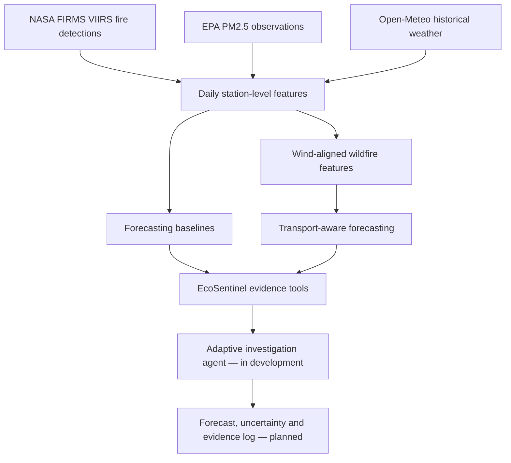

<div align="center">

# 🌎 EcoSentinel

### Toward Agentic AI for Wildfire-Aware Air Quality Forecasting

**Satellite wildfire observations · Air quality monitoring · Meteorology · Autonomous evidence selection**


*A research prototype investigating whether uncertainty-aware, adaptive environmental evidence selection can improve next-day PM2.5 forecasting and make environmental risk assessments more efficient and transparent.*

</div>

---

## Overview

Wildfire smoke can cause sharp, localized increases in fine particulate pollution (PM2.5). Predicting these episodes is challenging: fire detections alone do not tell us where smoke travels, and models that perform well on ordinary days can severely underestimate extreme events.

**EcoSentinel** explores two connected questions:

1. **Forecasting:** Can satellite-derived wildfire activity, local weather conditions, and simplified wind-aligned transport features improve next-day PM2.5 concentration predictions at EPA monitoring stations?
2. **Agentic investigation:** Can an AI agent decide *which environmental evidence to retrieve next*, rather than running an identical data-gathering pipeline for every station and day?

The **forecast target** is the next calendar day's 24-hour average PM2.5 concentration, in **µg/m³**, for a specific California EPA monitoring station. It is **not** a wildfire occurrence forecast or a statewide AQI forecast.

> **Project status:** Historical data integration, machine-learning baselines, and an initial wind-aligned wildfire feature are implemented. Environmental tool interfaces are implemented; agentic decision policies and rigorous held-out evaluation are in development. Results below are exploratory, **not operational air-quality forecasts**.

## Research workflow



## Data and scope

| Source | Role | Study scope |
|---|---|---|
| [NASA FIRMS](https://firms.modaps.eosdis.nasa.gov/) — NOAA-20 VIIRS | Fire detections and fire radiative power (FRP) | California, July–September 2025 |
| [US EPA AirData](https://aqs.epa.gov/aqsweb/airdata/download_files.html) | Daily PM2.5 measurements and monitoring-station locations | 97 California stations |
| [Open-Meteo Historical Weather API](https://open-meteo.com/en/docs/historical-weather-api) | Temperature, relative humidity, wind and precipitation | Daily weather features for 97 station locations |

Approximate research dataset sizes:

- **21,694** filtered VIIRS detections.
- **8,548** cleaned EPA station-day observations.
- **8,924** station-day weather and transport feature records (97 stations × 92 days).
- **8,283** model-ready next-day forecasting records.

These figures describe a specific retrospective experiment, not continuously updated live coverage. Raw and processed datasets are excluded from Git to avoid committing large generated files.

## Methods

### 1. Daily PM2.5 forecasting

Models use current-day pollution and optional environmental features to predict the following day's PM2.5 concentration. Features explored include:

- Same-day PM2.5 concentration and historical lags.
- Nearby fire detection counts (50 km and 100 km), FRP sums, and temporal fire history.
- Daily mean temperature, **relative humidity**, wind speed, wind-direction components, and precipitation.
- Wind-aligned fire radiative power within 100 km (`upwind_frp_100km`).

### 2. Wind-aligned wildfire activity

A preliminary feature weights each detected fire by its geographic distance and alignment with the station's **wind-from** direction:

\[
W_{ij} = \max\bigl(0,\cos(\theta_{ij}-\phi_i)\bigr)\,e^{-d_{ij}/50}
\]

Here, \(\theta_{ij}\) is the station-to-fire bearing, \(\phi_i\) is the daily mean wind-from direction, and \(d_{ij}\) is distance in kilometers. The feature sums weighted FRP for detections within 100 km.

**Important:** This is an exploratory directional exposure proxy, **not** a validated smoke-dispersion or atmospheric transport model. Daily surface winds can miss changes in wind over time and altitude.

### 3. Agentic environmental investigation (in progress)

Three callable, historical-data tools have been implemented:

| Tool | Returns |
|---|---|
| `fire_tool` | Fire counts and FRP near a selected monitoring station |
| `weather_tool` | Temperature, humidity, wind and precipitation |
| `transport_tool` | Wind-aligned wildfire FRP |

The next step is an agent that chooses which tool to call under a limited evidence-acquisition budget, logs its decisions, and updates its assessment. Planned evaluations will compare fixed pipelines, deterministic selection policies, and LLM-based planning.

## Preliminary results

**Next-day PM2.5 predictions; September 2025 test period.** Metrics are in µg/m³; lower is better.

| Random Forest feature set | MAE ↓ | RMSE ↓ |
|---|---:|---:|
| PM2.5 + Weather | 2.4232 | 11.3334 |
| PM2.5 + Fire + Weather | 2.4107 | 11.3440 |
| **PM2.5 + Fire + Weather + Wind-aligned FRP** | **2.4041** | **11.3104** |

All three models were compared on the same observations using a chronological train/test split and a common Random Forest configuration. The transport-aware version had the lowest error in this exploratory comparison, but **the differences are small** and have not been confirmed on an independent held-out period.

**An important failure case:** On September 8, 2025, a Mono County monitoring station recorded a next-day PM2.5 value of **427.9 µg/m³**. Earlier Random Forest baselines predicted only about **25–37 µg/m³**, underscoring the difficulty of extreme-event forecasting. This event has **not** been causally attributed to a specific wildfire by this project.

## Repository structure

```text
EcoSentinel/
├── notebooks/
│   ├── 01_fire_exploration.ipynb
│   ├── 02_air_quality.ipynb
│   ├── 03_fire_pm25_integration.ipynb
│   ├── 04_pm25_forecasting.ipynb
│   ├── 05_baseline_models.ipynb
│   ├── 06_weather_integration.ipynb
│   ├── 07_statewide_weather.ipynb
│   ├── 08_weather_forecasting.ipynb
│   ├── 09_transport_aware_features.ipynb
│   ├── 10_transport_forecasting.ipynb
│   └── 11_agentic_investigator.ipynb
├── experiments/
│   └── baseline_model_results.csv
├── data/                    # local datasets; ignored by Git
├── src/                     # reusable modules planned
├── reports/                 # research reports planned
├── .gitignore
└── README.md
```

The numbered notebooks document the project in development order. Some later notebooks are still in progress; code has not yet been consolidated into a reproducible package.

## Getting started

### 1. Clone the repository

```bash
git clone https://github.com/sumanth-1810/EcoSentinel.git
cd EcoSentinel
```

Replace `YOUR_USERNAME` with the repository owner's GitHub username.

### 2. Create a Python environment

```bash
python3 -m venv .venv
source .venv/bin/activate  # macOS/Linux
python -m pip install --upgrade pip
```

### 3. Install notebook dependencies

For the initial notebook workflow:

```bash
pip install pandas numpy scikit-learn matplotlib jupyter requests geopandas folium
```

Other notebook-specific packages may be needed. A pinned `requirements.txt` and automated dataset preparation are planned; the repository is **not yet fully reproducible from a fresh clone**.

### 4. Obtain the data

Download the relevant FIRMS VIIRS fire data and EPA daily PM2.5 records from the sources linked above. Open-Meteo historical weather is obtained through its API. Follow the numbered notebooks for cleaning, merging, feature creation and experiments. Their existing local file paths expect generated files in `data/raw/` and `data/processed/`.

**Data availability note:** Original and derived datasets are not included in this repository. A scripted end-to-end data setup process is planned.

## Roadmap

- [x] Filter California satellite wildfire detections.
- [x] Clean and align EPA PM2.5 station-day measurements.
- [x] Engineer geographic wildfire proximity features.
- [x] Train persistence and Random Forest forecasting baselines.
- [x] Integrate daily weather, including humidity and wind.
- [x] Build an initial wind-aligned FRP feature.
- [x] Implement callable fire, weather and transport evidence tools.
- [ ] Enforce realistic observation-availability cutoffs in historical replay.
- [ ] Implement sequential deterministic evidence selection with a tool budget.
- [ ] Quantify prediction uncertainty and calibrate confidence estimates.
- [ ] Add LLM-based tool planning with constrained actions and audit logs.
- [ ] Evaluate performance versus investigation cost on independent periods/events.
- [ ] Package the pipeline, pin dependencies, and publish reproducible run instructions.

## Research limitations and responsible interpretation

- **Retrospective inputs:** Finalized EPA measurements and historical weather reanalysis may not have been available at the time a real forecast would be issued. Operational claims require strict as-of-time data availability.
- **Repeated September evaluation:** September 2025 has informed feature development; it should be treated as an exploratory benchmark, not an untouched final test set.
- **Rare extreme events:** The study has relatively few highly polluted test examples, making estimates of extreme-event accuracy unstable.
- **Smoke attribution:** Spatial overlap between fire activity, wind and pollution does not by itself establish wildfire-caused PM2.5.
- **No operational alerting:** EcoSentinel is an experimental research project, not a public-health warning service.

## Research direction

The longer-term goal is to test whether **autonomous, uncertainty-aware observation selection** can make environmental investigations more accurate, efficient and interpretable than static pipelines. A credible result will require comparing forecasting quality, data acquisition cost, and the validity of each evidence request under realistic information constraints.

---

<div align="center">

**EcoSentinel is an active research project.** Follow the commit history to see its development, experiments, and evolving agentic AI components.

</div>
